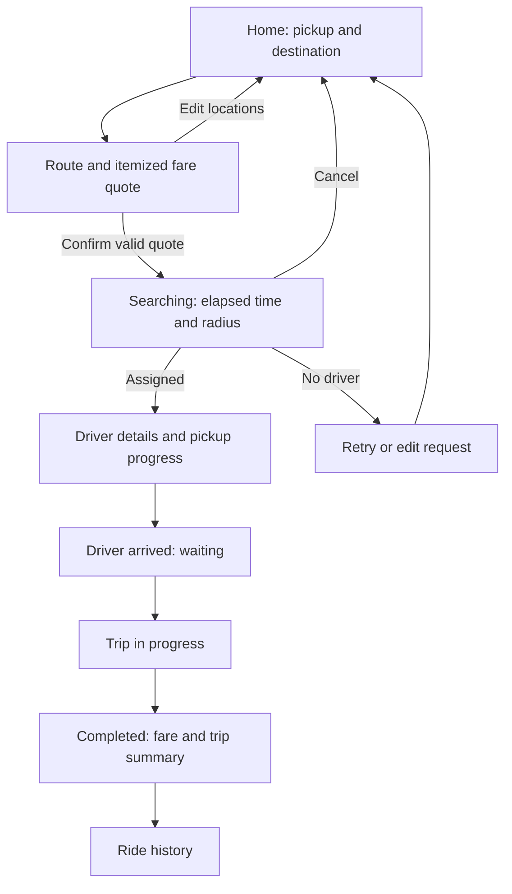
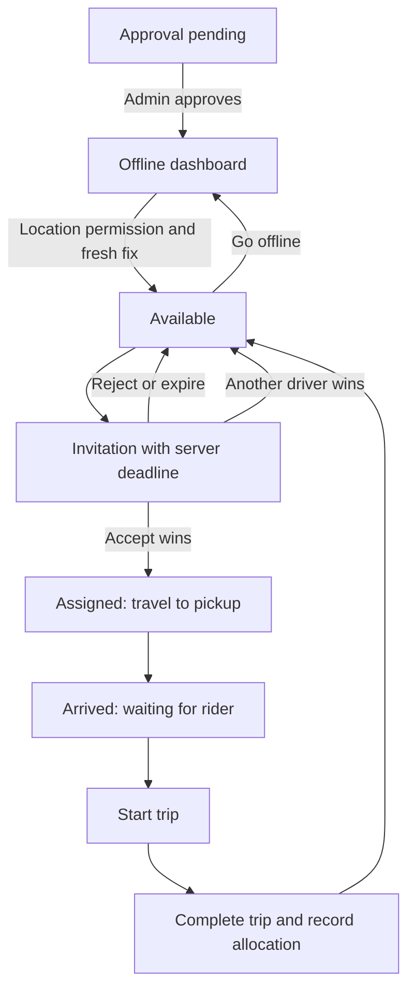

# Screen flows

## Shared entry

`/` → public landing → `/login` or `/register` → role workspace.

Registration supports rider/driver selection, name, country code/mobile, password, and consent. Show the generated permanent account code on success. Driver registration shows pending approval. Admin access is provisioned outside public registration. Login uses mobile/password, generic failure messages, and no OTP screens.

Unauthorized routes return to login with a safe internal return path; role mismatches show access denied. Logout clears client state and revokes the refresh session. Existing active rides are restored from the API after login/reload.

## Rider

| Route | Contents and states |
| --- | --- |
| /rider | Map, pickup/destination search, manual entry if location permission denied, route-provider error |
| /rider/quote | Distance, duration, base/distance/time amounts, surge reason, total, expiry; refresh expired quote |
| /rider/rides/:id | Search, no driver, assigned, arriving, waiting, ongoing, completed, cancelled; server-derived actions |
| /rider/history | Paginated trips and details; empty/loading/error states |
| /account | Profile, permanent code, logout |

Searching shows the actual server round/deadline and cancellation option. Assignment shows driver/vehicle details. A disconnected view shows connection status and resyncs before enabling stale actions. No payment-success claim appears without payment processing.

## Driver

| Route | Contents and states |
| --- | --- |
| /driver | Approval/status, availability control, location freshness, current assignment; permission-denied/stale warnings |
| Invitation overlay | Pickup summary, estimated fare, server countdown, accept/reject; clear expired/unavailable feedback |
| /driver/rides/:id | Route, pickup/destination, allowed next action, progress; confirmation before starting/completing |
| /driver/earnings | Trip allocations and historical percentage; distinguish allocated from paid |
| /driver/history | Completed/cancelled trips with details |

Do not display a successful acceptance until the server confirms it. Suppress expired popups and restore invitations after reconnect. Offline controls cannot bypass an active-trip incident policy. Browser tracking limitations are stated near availability controls.

## Admin

`/admin` overview → drivers, rides, fare rules, surge zones, revenue settings, audit.

| Route | Contents and actions |
| --- | --- |
| /admin | Active rides, available/stale drivers, unassigned requests, operational exceptions |
| /admin/drivers | Approval queue, searchable statuses, driver detail, approval/suspension with reason |
| /admin/rides | Filter by status/date; ride timeline, matching rounds, quote and settlement detail |
| /admin/fares | Versioned base/distance/time/minimum rates and effective dates |
| /admin/surge | Zone definition, timezone/schedule, multiplier/cap, enable/pause; validation and empty state |
| /admin/revenue | Default 85/15, validated edits totaling 100%, effective date and required change reason |
| /admin/audit | Paginated actor/action/entity/time filters and before/after detail |

Admin edits show validation before submission and server errors afterward. Historical quotes and settlements remain unchanged when settings change. Initial operational pages are read-only except specifically authorized actions; no arbitrary ride-state editing.

## First implementation review

Review responsive login/registration and the rider, driver, and admin shells first. Then review one complete simulated ride with two role sessions. The slice is complete only when reload preserves the ride, unauthorized access fails, two drivers cannot both win, and completion records exactly one allocation.
